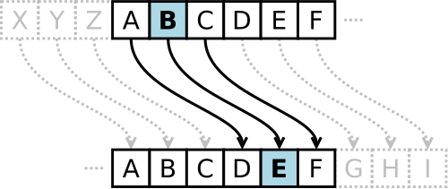
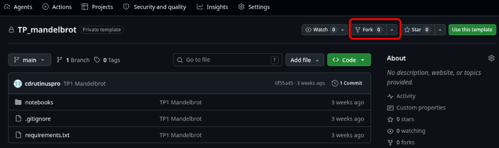
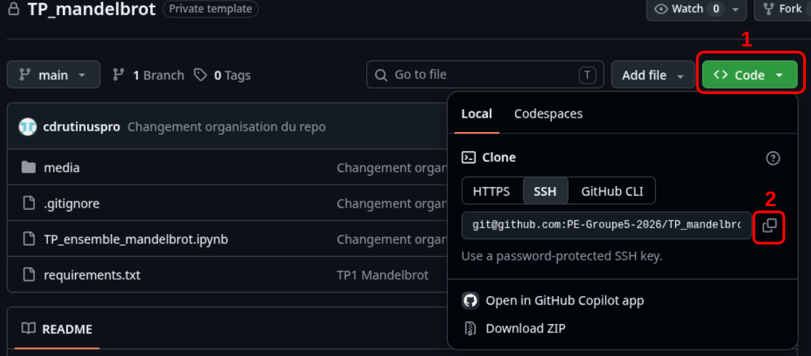
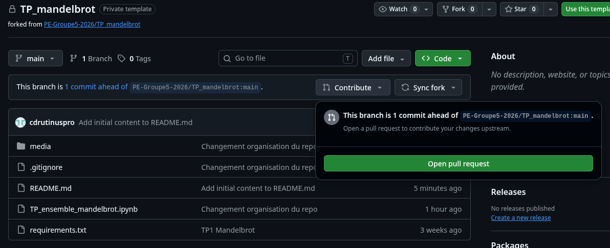
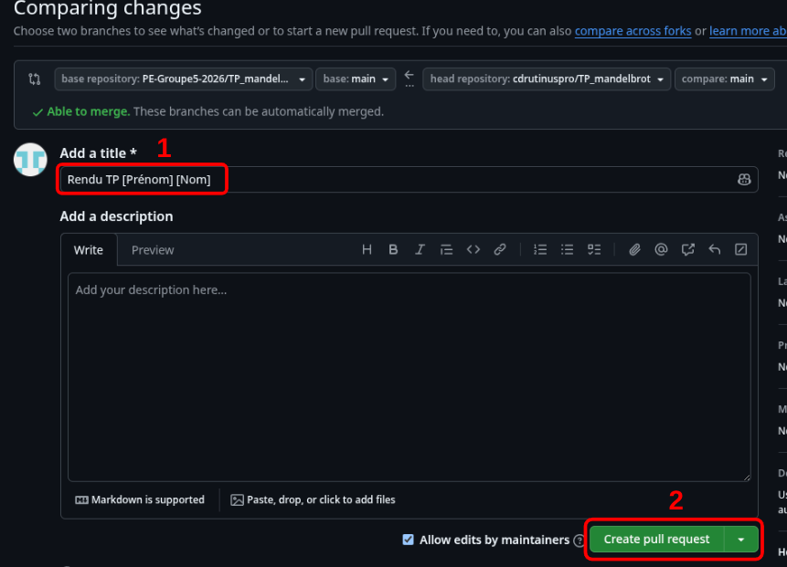

# TP - Introduction à la cryptographie : le chiffrement de César

Jules César aurait utilisé ce procédé pour protéger ses messages militaires : chaque lettre est **décalée d'un nombre fixe `k` de positions** dans l'alphabet. Avec `k = 3`, `a` devient `d`, `b` devient `e`, … et `z` devient `c` (on « reboucle »).



Dans ce TP, vous allez :

1. chiffrer un caractère ;
2. chiffrer un message complet ;
3. le déchiffrer ;
4. casser un message par force brute ;
5. casser un message grâce à l'analyse fréquentielle ;
6. *(bonus)* découvrir le chiffre affine.


**Nous rappelons que l'utilisation d'un agent IA est strictement interdite dans le cadre de ce cours.**
\
\
Cependant, vous avez évidemment le droit d'utiliser des ressources en ligne pour vous aider, notamment, la documentation de la librairie numpy (pour plus d'informations sur les fonctions ou types utilisés) ainsi que le site stackoverflow qui consigne beaucoup de solutions à des problèmes courants.


# Rappels pour Git


## Créer un fork
Un fork est une "copie personnelle" du repository sur laquelle vous aurez tous les droits et pourrez travailler. Pour ne pas tout casser, il est **obligatoire** de créer un fork.

1. Sur GitHub, cliquer en haut à droite sur le bouton <code>fork</code>



2. Valider la création du fork en cliquant sur <code>Create fork</code>
3. Vous serez alors dirigé vers ce nouveau repo nouvellement créé.

## Récupérer le repository en local (sur votre ordinateur)
Une fois le fork créé, il vous faut télécharger le contenu du repository pour travailler sur votre ordi (avec VSCode, Jupyter, etc.).

1. Cliquer sur le bouton vert <code>code</code> et copier l'adresse (https ou ssh en fonction de votre configuration)



2. Dans un terminal git, se positionner au bon endroit dans votre arborescence (commande <code>cd</code>) et cloner le repository.
```bash
git clone adresse_copiee
```
(en remplaçant évidemment la bonne adresse dans la commande précédente)


## Faire un commit
En local, lorsque vous avez effectué des modifications, vous pouvez faire un commit pour les "enregistrer" dans git.

1. Dans un terminal git, vérifier les modifications avec la commande
```bash
git status
```

2. Faire un commit **en indiquant bien un message pour documenter vos modifications**.
```bash
git add .
git commit -m "Message de description des modifications"
```
(git add permet d'ajouter les modifications dans la stage avant de commit)


## Pousser les modifications
Une fois votre travail effectué, vous allez vouloir pousser vos modifications en ligne sur **votre** fork.

1. Dans un terminal git, s'assurer que vous avez bien commit : le résultat de la commande
```bash
git status
```
doit vous renvoyer *nothing added to commit but untracked files present (use "git add" to track)*.

2. Pousser vos commits sur votre fork:
```bash
git push origin main
```

3. Aller sur votre repo sur GitHub (actualiser la fenêtre si besoin) et vérifier que vos modifications apparaissent bien.


## Rendre le TP (faire une Pull Request)
Une Pull Request permet d'ajouter les modifications enregistrées sur votre fork au repo général, originel. Ce sera pour vous l'occasion de rendre votre TP.

1. Depuis votre fork sur GitHub, vérifier que votre fork est en avance sur le repo général.
2. Cliquer sur le bouton <code>Contribute</code>.
3. Ouvrir la Pull Request.



4. **Indiquer votre prénom et nom** puis valider la pull request.


